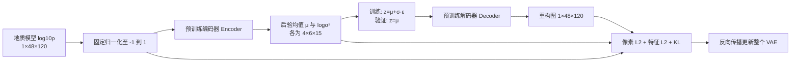

# LWD VAE 训练与代码阅读指南

本次统一为 CSEM 论文描述的 KL-f8 微调主线。基础权重是**通用图像数据上训练好的 KL-f8**，再用 LWD 地质模型微调；不是在随机网络上从头训练，也不是加载 CSEM 已微调的地质权重。

“相同”指网络家族、预训练迁移、通道适配和损失组成相同。原论文未公开的数值超参数、特征层与归约方式不能凭现有材料恢复，见 [逐项对应说明](docs/CSEM_ALIGNMENT_CN.md)。

## 1. 一张图怎样经过 VAE



1. 磁盘保存的 `m=log10(ρ / Ωm)` 是物理量，不是 PNG 颜色。训练不读取彩色预览图。
2. 根据数据集固定上下界 `a=-1,b=3`，计算 `u=2(m-a)/(b-a)-1=(m-1)/2`。不对每张图单独拉伸对比度。例如 ρ=10 Ωm 对应 m=1、u=0；ρ=100 Ωm 对应 m=2、u=0.5。
3. Encoder 和 `quant_conv` 输出后验参数 `μ`、`logσ²`。本项目的潜变量形状为 `[B,4,6,15]`，单张图 360 个潜变量。图像 5760 个网格值，按元素数压缩 16 倍；潜变量每个方向下采样 8 倍。
4. 训练时用重参数化 `z=μ+exp(logσ²/2)ε`，使采样也能反向传播；验证和测试取 `z=μ`，避免随机抽样造成评价抖动。
5. Decoder 输出归一化重构图。输出层没有强制裁切，因此需监测越界比例；反变换为 `m̂=a+(û+1)(b-a)/2`。
6. 对比输入与输出计算损失，更新整个 Encoder、Decoder、两个 1×1 映射层。AlexNet 只算特征，不更新参数。

KL-f8 内部有空间 attention，它属于原网络。这里不加载扩散 UNet、文本编码器，不运行扩散采样，也不使用 Stable Diffusion 的 latent 缩放系数 `0.18215`。这只是独立 VAE。

## 2. “预训练后微调”具体做了什么

初始化使用官方原版 KL-f8 checkpoint，网络保持 `base_channels=128`、`channel_mult=[1,2,4,4]`、每级 2 个残差块、4 个 latent 通道。正式配置不允许随意缩小这些维度后继续声称加载了完整原模型。

通用模型处理 RGB，LWD 只处理一个 `log10ρ` 通道，所以只改变三个权重张量：

- `encoder.conv_in.weight`：沿 RGB 输入通道取均值，3→1。
- `decoder.conv_out.weight`：沿 RGB 输出通道取均值，3→1。
- `decoder.conv_out.bias`：RGB 三个偏置取均值。

其余 VAE 权重完整加载。文件不存在、任意 VAE 权重缺失、形状不匹配或含非有限值时直接报错，不静默退回随机初始化。checkpoint 中原始训练附带的 `loss.*` / `discriminator.*` 不进入当前优化目标。

正式微调时全部 VAE 参数可训练。冻结的是特征损失网络 AlexNet；预测图像通过它计算特征仍有梯度，所以它可以指导 Decoder 更新。微调的起点是通用视觉结构先验，LWD 数据决定新的地质分布。

## 3. 三项损失怎样理解

当前实现明确采用：

\[
L=L_{pixel}+\gamma L_{feature}+\beta L_{KL}.
\]

| 项 | 代码中的定义 | 作用 |
|---|---|---|
| 像素 L2 | 输入与重构的逐元素平方误差均值 MSE | 保持 `log10ρ` 数值和图像重构 |
| 特征 L2 | AlexNet 五个 ReLU 层各自 MSE，再对五层平均 | 约束多尺度图像特征；是否保留薄层需用实际重构验证 |
| KL | 每张图对 360 个潜变量求和，再取 batch 均值 | 约束后验接近标准正态，使潜空间保持规律 |

\[
L_{KL}=\frac{1}{B}\sum_b\frac12\sum_j(\mu_{bj}^2+e^{\ell_{bj}}-1-\ell_{bj}),\quad \ell=\log\sigma^2.
\]

AlexNet 输入：将 `[-1,1]` 映射回 `[0,1]`，单通道复制为三通道，再用 ImageNet 均值和标准差标准化；不改变空间尺寸。取 torchvision 特征索引 `[1,4,7,9,11]`。这是论文未交代细节的**显式实现选择**，不等价于 LPIPS 的归一化、标定层和加权距离。

日志同时记录原始值与 `weighted_feature`、`weighted_kl`。判断某项是否占主导，要比较加权后的贡献。本次真实权重的两步 CPU 检查中，三项平均贡献约为 0.0624、0.5410、0.0542，总损失 0.6575；这只解释日志含义，不是训练效果结论。γ=1 并不意味着特征项与像素项同样大。KL 系数与潜变量个数及求和/均值方式有关；不能不检查定义就把其他脚本里的 `1e-5`、`0.1`、`1` 直接互换。

## 4. 各个文件做什么

| 文件 | 负责什么 | 建议何时读 |
|---|---|---|
| `configs/vae_finetune_csem.json` | 路径、固定架构、损失与训练参数；记录参数来源 | 第一份 |
| `train_vae.py` | 极薄入口，调用 CLI | 理解如何启动 |
| `lwd_vae/finetuning/cli.py` | 命令行参数、默认配置、测试模式保护 | 对照运行命令 |
| `lwd_vae/finetuning/config.py` | 严格检查字段和正式训练约束；解析相对路径 | 修改参数时 |
| `lwd_vae/dataset.py` | 读取 NPY/manifest，固定归一化，检查坐标和范围 | 看输入如何变为 tensor |
| `lwd_vae/finetuning/model.py` | 组装原版 Encoder/Decoder/高斯后验与 1×1 层 | 看 encode/decode |
| `lwd_vae/vendor/compvis/` | 原始卷积、残差、attention、后验计算；有来源与哈希 | 后续深入网络结构 |
| `lwd_vae/weights.py` | 完整加载预训练权重、单通道转换、记录 SHA256 | 理解微调起点 |
| `lwd_vae/finetuning/features.py` | 冻结 AlexNet，抽取五层特征 | 理解特征损失 |
| `lwd_vae/finetuning/losses.py` | 三项损失及固定系数组合 | 学习目标函数 |
| `lwd_vae/finetuning/preflight.py` | 用实际权重和输入检查一次前向 | 训练前检查 |
| `lwd_vae/finetuning/trainer.py` | batch 循环、优化、验证、最佳模型、断点续训 | 最后串起全流程 |
| `lwd_vae/runtime.py` | 设备、随机数、原子保存、数据指纹 | 理解可复现性 |
| `test_vae.py` / `lwd_vae/evaluation.py` | test/OOD 独立评估、按类型统计与重构图 | 训练完成后 |
| `lwd_vae/inference.py` | 直接接受/返回物理 `log10ρ`，保留 latent 梯度 | 接入反演时 |
| `lwd_vae/mapping.py` | 单元坐标和 Fortran 顺序展平 | 对接反演网格 |
| `prepare_pretrained.py` | 下载、校验官方基础模型和 AlexNet | 首次准备环境 |
| `generate_dataset.py` / `lwd_vae/generation.py` | 地质模型生成；不调用电磁正演 | 改地质先验时 |
| `references/`、`lwd_vae/legacy/` | 历史脚本与旧 checkpoint 兼容；不参与当前训练 | 仅复查历史 |

推荐读代码顺序：**配置 → dataset → model → weights → features/losses → trainer → inference**。建议先跟踪一个 batch 的形状，理解后再研究第三方卷积细节。

## 5. 关键参数

以下数值为本次 LWD 起点，不是已核实的 CSEM 最终超参数。

| 配置项 | 默认值 | 意义与调整方式 |
|---|---:|---|
| `paths.dataset` | `datasets/lwd_global_v2_2` | 固定 train/val/test 划分，训练只打开前两者 |
| `paths.vae_weights` | `weights/vae/kl_f8_original.ckpt` | 通用预训练 VAE，不是 LWD 最终结果 |
| `paths.alexnet_weights` | `weights/perceptual/alexnet_imagenet.pth` | 冻结 ImageNet 特征网络 |
| `paths.output` | `runs/csem_kl_f8_lwd_v1` | 每次实验新目录，拒绝覆盖 |
| `training.batch_size` | 4 | 每步使用的图像数；增大受显存限制 |
| `training.epochs` | 10 | 完整遍历训练集的轮数；不是 10 次参数更新 |
| `optimizer.learning_rate` | `1e-4` | 每步更新幅度；发散时减小，改变后另存实验 |
| `optimizer.momentum` | `0.9` | SGD 使用历史梯度方向 |
| `optimizer.weight_decay` | `5e-4` | SGD 中的参数衰减，与 KL 不是同一项 |
| `loss.feature_weight` γ | `1.0` | 冻结特征损失相对像素损失的权重 |
| `loss.kl_weight` β | `1e-5` | KL 约束强度；过强可能损害重构，需观察实际贡献 |
| `training.precision` | `float32` | 起步容易检查数值；CUDA 可选 float16/bfloat16，需硬件支持 |
| `training.grad_clip_norm` | `null` | 默认不裁剪，但检查梯度是否有限 |
| `training.patience` | 0 | 默认不提前停止；正整数表示验证不改善多少轮后停止 |
| `training.min_delta` | 0 | 早停所需最低改善量，不改变 best.pt 的最小 RMSE 选择规则 |
| `training.seed` | 20261104 | 打乱顺序、采样、随机数复现 |
| `training.workers` | 0 | 数据加载子进程数；有需要再增大 |
| `training.max_train_samples` / `max_val_samples` | `null` | 正式使用完整 split；仅短流程验证时截取前 N 张 |

正式数据 20,000 张、batch=4，每轮 5,000 个 batch；10 轮共 50,000 次尝试更新。AMP 溢出造成的跳步单独记录。不要把论文所说的“10 steps”直接解释为这个预算已被证明足够。

训练不额外混入 TV、梯度重构、判别器、LPIPS、EMA 回写或 KL warmup。训练效果要靠固定验证集来判断，不能由损失名称或训练轮数保证。

## 6. 运行、预检查和恢复

Python ≥3.10；安装匹配硬件的 PyTorch/torchvision 后，按 `requirements-training.txt` 补齐依赖。训练不需要 Lightning、W&B 或外部 ldm 仓库。所有训练相对路径均以项目根目录为基准，因此从其他目录启动也不会误读文件。

```bash
python prepare_pretrained.py
python prepare_pretrained.py --check-only
python train_vae.py --print-config
python train_vae.py --check-only --device cpu
python train_vae.py --device cuda:0 --output runs/csem_kl_f8_lwd_v1
```

本地只有小数据集时，给 `--dataset datasets/smoke_global_v2_2`；正式数据已在服务器。`--check-only` 校验所有 train/val 数据、完整加载 VAE 与 AlexNet，再做一张真实图像的前向计算，不创建 run 目录，不更新参数。

```bash
# 机器间路径不同，只覆盖路径即可
python train_vae.py --dataset /absolute/datasets/lwd_global_v2_2 \
  --pretrained /absolute/weights/kl_f8_original.ckpt \
  --alexnet-weights /absolute/weights/alexnet_imagenet.pth \
  --output /absolute/runs/csem_v1 --device cuda:0

# 延续同一实验：总共训练到 20 轮，不是额外增加 20 轮
python train_vae.py --resume runs/csem_kl_f8_lwd_v1/checkpoints/last.pt \
  --epochs 20 --output runs/csem_kl_f8_lwd_v1_continue --device cuda:0
```

续训从 checkpoint 恢复配置、模型、冻结特征网络、优化器、AMP 和随机状态。不需要再次读取最初的外部权重；需要保留同目录 `best.pt`。数据搬家可以改变路径，数据指纹必须一致。改变学习率/损失后应另起实验，不把它伪装为完全相同配置的续训。

旧 v1/v2 checkpoint 仍支持独立评价；当前入口只续训 v3 状态，以免把历史逆散射损失无声接入新路线。随机权重、缩小架构只允许 `purpose=smoke_test`，命令行还需 `--allow-smoke-test`；其结果不能作为正式 LWD 先验。

## 7. 看哪些输出，怎样判断有进步

```text
runs/某次实验/
  run_config.json          实际参数、设备、代码来源、权重哈希和数据身份
  initial_validation.json 微调前的验证误差（续训保留原实验起点）
  summary.json             最佳轮次、最终状态、是否优于微调前
  logs/history.csv         每轮三项损失、加权贡献、验证误差和耗时
  checkpoints/best.pt      验证集 log10ρ RMSE 最低的完整训练状态
  checkpoints/last.pt      最近完整一轮，供续训使用
```

`best.pt` 总是选本次训练过程中的最佳轮次；若所有轮次都比通用预训练模型差，`improved_over_initial=false`，不能把“保存了 best”理解为迁移有效。输出不裁切，越界比例也记录。不同硬件/软件之间不承诺逐位一致。

```bash
python test_vae.py --dataset datasets/lwd_global_v2_2 \
  --checkpoint runs/csem_kl_f8_lwd_v1/checkpoints/best.pt \
  --device cuda:0 --output evaluations/csem_kl_f8_lwd_v1 --save-reconstructions
```

先检查均匀模型是否出现伪层、薄层是否消失、层界是否偏移、背斜和断层是否被抹平，再查看按九类及强弱对比分组的误差。test 与 OOD 留到模型确定后做独立评价。

最后还需将原模型和重构模型送入同一 LWD 正演程序，比较电磁响应误差。像素重构好不能直接证明反演会更准；工具倾角是正演中已知的几何条件，本阶段不作为图像旋转或 VAE 的未知地质参数。

## 8. 两种短流程检查的区别

- `configs/testing/vae_smoke.json`：小网络、随机初始化，不下载大权重，只检查代码流程；必须显式 `--allow-smoke-test`。
- `configs/testing/vae_pretrained_check.json`：完整 KL-f8（本实现 83,649,253 个可训练参数）、真实官方权重、真实 AlexNet 特征损失；仅 2 张 train + 2 张 val、1 epoch，用于验证正式微调能运行。它仍不是收敛后的模型。

```bash
python train_vae.py --config configs/testing/vae_pretrained_check.json \
  --device cpu --output runs/validation_pretrained_csem_v3
```

本机短流程使用 `datasets/smoke_global_v2_2`。服务器只有正式数据时可追加 `--dataset datasets/lwd_global_v2_2`，仍只截取配置规定的样本数；正式训练则使用默认配置的完整 split。

服务器独立环境放在 `/home/wytao/projects/VAE_LWD2p5Inversion/.venv`，不修改正反演工程原 conda 环境。当前 V100 机器使用 PyTorch 2.6.0、torchvision 0.21.0 的 CUDA 12.4 构建；安装组合依据 [PyTorch 官方版本说明](https://pytorch.org/get-started/previous-versions/)。在服务器运行时以 `.venv/bin/python` 代替上述 `python`。
